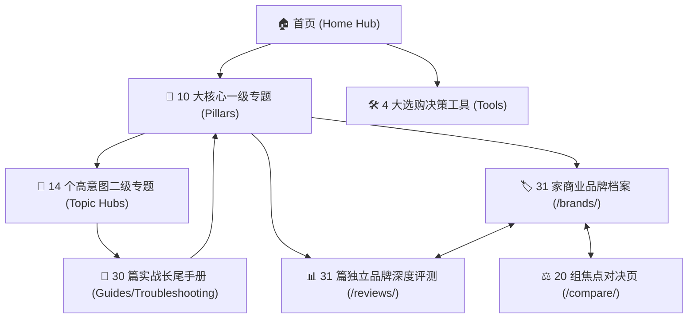

<div align="center">

# 🌐 机场指南 (jichang.biz)
### Airport Decision Hub 1.0 · 中立透明、有据可循的网络服务选购决策中心

[](https://astro.build/)
[](https://www.typescriptlang.org/)
[](https://tailwindcss.com/)
[](https://pagefind.app/)
[-22c55e?style=for-the-badge&logo=google&logoColor=white)](#-全站质量与交付指标)
[](LICENSE)

<p align="center">
  <a href="https://jichang.biz/">官方线上站点</a> •
  <a href="#-核心特性">核心特性</a> •
  <a href="#-内容与拓扑矩阵">拓扑架构</a> •
  <a href="#-快速上手">本地开发</a> •
  <a href="#-生产构建与部署">部署指南</a> •
  <a href="#-合规声明">法律合规</a>
</p>

</div>

---

## 📖 项目简介

**机场指南 (jichang.biz)** 是一个面向合法授权使用场景（跨境远程办公、外贸学术科研、企业合规出海）的专业网络服务选购决策、套餐对比、品牌实测资料与技术排障支持平台。

针对网络加速服务行业长期存在的“佣金伪装排行榜”、“参数严重虚标”、“跑路前兆隐蔽”等信息不对称痛点，本项目坚持**“证据与商业展示分离”**的原则，汇编了 **31 家去重品牌** 的物理线路、真实月均成本、客户端支持度与 AI 解锁能力，并配套全平台客户端配置与故障排查 SOP。

---

## ⚡ 核心特性

- 🏛️ **31 家去重实体客观档案**：严格区分“实测核验 (verified)”与“商家宣称 (vendor)”，对冲突字段与历史变更诚实标注，绝不捏造 0 丢包伪证。
- ⚖️ **四维量化评分体系**：综合评分（线路质量 35% + 稳定性 25% + 性价比 20% + 客户端支持 20%），透明可溯源，彻底告别虚假星级诱导。
- 🚀 **100% 纯静态 SSG 输出**：基于 Astro 5 构建，无 JavaScript 情况下正文、数据对比表、导航及链接仍 100% 完整可读；客户端按需零水合。
- 🔍 **Pagefind 毫秒级离线搜索**：集成 WebAssembly 中文分词搜索，154 页面、29,500+ 中文词条全站即时检索。
- 🛡️ **严格商业透明度披露**：合作品牌位全站显式提示；所有商业跳转统一附加 `target="_blank" rel="nofollow sponsored noopener"`，无任何暗箱操作。
- 🤖 **GEO & AEO 深度优化**：全站 154 页面标配首屏 Answer-First 核心摘要，内嵌 734 组 JSON-LD 结构化数据（Organization, WebSite, CollectionPage, Review, FAQPage, Article），适配 Google AI Overviews、Perplexity、ChatGPT Search 索引。

---

## 🏗️ 架构设计与内链拓扑

本项目采用严密的**五层内链拓扑网络**，确保全站页面点击深度 $\le 3$，权重高效顺畅流转：



### 10 大核心一级专题 (Pillars)
| 路由路径 | 专题定位 | 核心模块数 | 覆盖场景 |
| :--- | :--- | :---: | :--- |
| [`/recommend/`](https://jichang.biz/recommend/) | 机场推荐与选购决策 | 16 模块 | 综合天梯榜、靠谱筛选、小白上手、性价比横评 |
| [`/pricing/`](https://jichang.biz/pricing/) | 资费套餐与成本核算 | 17 模块 | 便宜月付、一元机场真相、不限时大流量包 |
| [`/brands/`](https://jichang.biz/brands/) | 全部品牌实体档案库 | 16 模块 | 31 家品牌实时参数筛选与防伪溯源 |
| [`/vpn/`](https://jichang.biz/vpn/) | 商业 VPN 与加速鉴别 | 16 模块 | OSI 三层虚拟专用网 vs 代理、合规法律边界 |
| [`/clients/`](https://jichang.biz/clients/) | 全平台客户端下载核验 | 16 模块 | 6 大操作系统官方源校验与参数档案 |
| [`/compatibility/`](https://jichang.biz/compatibility/) | AI 与流媒体解锁证据库 | 16 模块 | ChatGPT/Claude 1020 破局、Netflix 4K 解锁 |
| [`/network/`](https://jichang.biz/network/) | 专线架构与节点科普 | 18 模块 | IEPL/IPLC 物理不过墙原理、BGP 隧道、倍率陷阱 |
| [`/guides/`](https://jichang.biz/guides/) | 配置教程与进阶手册 | 18 模块 | TUN 虚拟网卡接管、分流规则、订阅安全管理 |
| [`/troubleshooting/`](https://jichang.biz/troubleshooting/) | 故障排查标准规程 (SOP) | 17 模块 | 节点超时、订阅失败、端口冲突、DNS 泄露应急 |
| [`/risk/`](https://jichang.biz/risk/) | 风险预警与双机场容灾 | 18 模块 | 跑路前兆 5 大信号、退款条款辨析、双机场热备 |

---

## 📊 全站质量与交付指标

在上线前预防性深度技术审计与全站自动化测试中，各项指标表现如下：

```text
======================================================
== [QA MASTER AUDIT] Comprehensive Production Suite ==
======================================================
✔ 编译产物页面数: 154 个纯静态 HTML（Astro SSG 编译耗时 3.92s）
✔ Pagefind 中文分词索引: 29,525 个有效词条（毫秒级端侧离线搜索）
✔ 全站内外部链接扫描: 11,666 条链接，0 损坏（Broken Links: 0）
✔ 商业外链合规覆盖率: 100% 严格配置 rel="nofollow sponsored noopener"
✔ 结构化数据校验: 734 组 JSON-LD（Schema.org 语法 100% 合规通过）
✔ 搜索引擎预防性审计评级: 98 / 100 (A+)（0 项 P0，0 项 P1 隐患）
✔ 站长平台验证能力: Google / Bing / 百度 / 神马 安全预留就绪
```

---

## 📁 项目目录结构

```text
jichang.biz/
├── data/                  # 关键词映射库 (keywords/) 与 GEO 问答库 (questions.json)
├── public/                # 纯静态资源
│   ├── images/            # 原创品牌矢量标识与几何罗盘 Logo
│   ├── .htaccess          # Apache / OpenLiteSpeed 301 强制裸域、HTTPS 与伪静态
│   ├── _redirects         # Cloudflare Pages 重定向规则
│   ├── favicon.svg        # 矢量网站图标
│   ├── llms.txt           # 大语言模型抓取元描述清单
│   └── robots.txt         # 针对主流引擎及 AI 爬虫的白名单抓取规范
├── reports/               # 预防性 SEO 审计报告、QA 报告与质量验收文档
├── scripts/               # 自动化数据校验、链接巡检、Schema 校验与 QA 脚本
│   ├── validate.cjs       # 品牌实体与长尾数据源完整性校验
│   ├── link-check.cjs     # 1.1w+ 链接死链与 nofollow 自动化扫描
│   ├── schema-check.cjs   # JSON-LD 语法与结构化数据校验
│   └── qa.cjs             # 全站上线综合验收主控脚本
├── src/
│   ├── components/        # 决策图表、测速报告、比对卡片、FAQ 与 SEOHead 组件
│   ├── data/              # 31 家品牌结构化数据 (brands.ts)、链接库 (links.ts)
│   ├── layouts/           # 页面基础骨架 BaseLayout (无障碍与主题支持)
│   ├── pages/             # 路由页面 (10 Pillars + 14 Hubs + 31 Reviews + 31 Brands + Tools)
│   ├── styles/            # Tailwind 全局样式定制与无障碍焦点规范
│   ├── types/             # 品牌、套餐与测速接口 TypeScript 类型定义
│   └── utils/             # 高性能 Markdown 语义解析引擎 (markdown.ts)
├── astro.config.mjs       # Astro 5 静态配置 (trailingSlash: 'always')
├── package.json           # 依赖项与 npm 指令
├── PROGRESS.md            # 项目全生命周期迭代推进与冲突决策备忘录
└── README.md              # 项目技术自述文档
```

---

## 🚀 快速上手

### 环境要求
- **Node.js**: `v18.20.0` 或更高版本（推荐 Node LTS `v20.x` / `v22.x`）
- **包管理器**: `npm`（随 Node 自带）

### 本地开发
```bash
# 1. 克隆代码仓库
git clone https://github.com/zlzlzl98698-dev/jichang.biz.git
cd jichang.biz

# 2. 安装项目依赖
npm install

# 3. 启动本地开发服务 (支持实时热重载)
npm run dev
# 浏览器访问 http://localhost:4321/
```

### 生产静态构建与 QA 验收
```bash
# 一键运行完整验证、Astro 静态编译、Pagefind 索引生成与 QA 验收
npm run build

# 本地预览生产构建产物
npm run preview
# 浏览器访问 http://localhost:4321/ 或预览指定端口
```

### 单元检查指令
```bash
npm run validate     # 校验 31 家品牌实体与 JSON/CSV 映射完整性
npm run link-check   # 扫描全站 11,000+ 条链接是否损坏或漏标 rel 属性
npm run schema-check # 校验全站 734 组 JSON-LD 结构化数据
npm run qa           # 执行全量自动化综合验收套件
```

---

## 🌐 部署指南

### 方案 A：Cloudflare Pages（官方默认推荐）
1. 登录 Cloudflare Dashboard，进入 **Workers & Pages** -> **Create Application** -> **Pages** -> **Connect to Git**；
2. 选择本仓库 `zlzlzl98698-dev/jichang.biz`；
3. **构建配置**：
   - **Framework preset**: `None` 或 `Astro`
   - **Build command**: `npm run build`
   - **Build output directory**: `dist`
4. 点击 **Save and Deploy**，即刻完成全球 Anycast CDN 静态秒级分发；
5. 在域名自定义域名设置中绑定 `jichang.biz`，并在 **Redirect Rules** 中配置 `www.jichang.biz` $\to$ `https://jichang.biz/` 的 301 永久重定向。

### 方案 B：Apache / OpenLiteSpeed / Nginx
- 编译产物位于 `dist/` 目录，直接将目录内所有文件上传至 Web 根目录即可；
- 根目录下已随附 `public/.htaccess`，已预先配置好 HTTPS 强制跳转、尾部斜杠自动补全、`sitemap.xml` 别名解析与 404 错误页响应。

---

## ⚖️ 商业透明度与合规声明

1. **合法授权原则**：本站所有内容与技术讨论均严格限定于符合目标市场法律法规之合规网络访问、外贸商务、学术交流与技术研究场景。
2. **中立性保障**：合作品牌位已通过 UI 标签明亮标示；客观技术评测得分与风险预警完全基于实际网络可观测性数据编制，不接受任何形式的赞助买断。
3. **商标与版权**：文中提及之第三方软件名称、协议名称及品牌标识，其版权归各自原始开发者或注册主体所有，本站引用仅用于技术辨识与客观评述。

---

<div align="center">
  <sub>Built with ❤️ by 机场指南编辑部 & 技术组 · 2026</sub>
</div>
