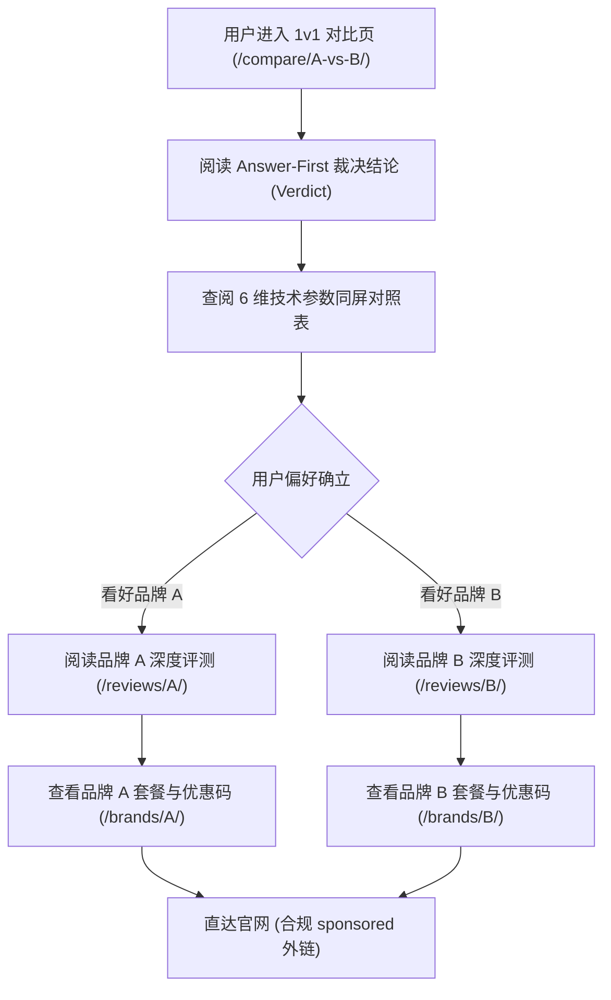

# 竞品对比与决策路径设计报告 (Brand Comparison Plan & Decision Architecture)

## 1. 竞品对比的设计初衷
在跨境网络消费决策中，单一品牌的孤立评测往往难以消除用户的“选择困难症”。
用户往往在 2-3 家预算相近、定位相似的品牌间犹豫不决（例如：“同样是 8 元左右，我该买光速云还是暮光云？”；“飞猫云和微风网络哪个晚高峰更稳？”）。
为此，「机场指南」在 `/compare/` 路由下设计并交付了 **20 组 1v1 焦点竞品横向横评系统**，打破模糊其辞的广告话术，给出明确的差异化决策裁决。

## 2. 20 组焦点对决分类与设计逻辑

| 序号 | 对决 Slug | 对决品牌 | 对决核心痛点与对比焦点 | 最终裁决倾向速读 |
| :---: | :--- | :--- | :--- | :--- |
| 1 | `guangsu-vs-muguang` | 光速云 vs 暮光云 | 老牌IEPL双专线 vs BGP大流量多设备同时在线 | 追求极致生产力与老牌稳健选光速云；家庭多设备与大流量选暮光云 |
| 2 | `feimao-vs-weifeng` | 飞猫云 vs 微风网络 | 7元专属客户端新手开箱 vs 纯IEPL专线VLESS进阶分流 | 小白开箱即用选飞猫；看重Clash规则分流与原生IP选微风 |
| 3 | `weitu-vs-firefly` | 唯兔云 vs Firefly | IPLC多开高自由度通用订阅 vs 纯IPLC专线封闭客户端 | 软路由与多平台通用选唯兔；手机单机纯傻瓜连接选Firefly |
| 4 | `jilian-vs-guangnian` | 极连快线 vs 光年网络 | 18元档针对AI优化 vs 18元档110GB微溢价流量包 | 重度ChatGPT/Claude选极连；追求稍多月流量选光年 |
| 5 | `dalaoyun-vs-shandianshu`| 大佬云 vs 闪电鼠 | 5.6元极限平价档同质化对决与抗压表现 | 二者规格几乎一致，均推荐作为低成本备用节点双活冗余 |
| 6 | `sogo-vs-yinxingren` | SogoCloud vs 隐形人 | 8元15国节点自研App vs 24元企业级IPLC直连大带宽 | 外贸轻度浏览选SOGO；高吞吐跨国跨境电商与重度会议选隐形人 |
| 7 | `xingdaomeng-vs-ermao` | 星岛梦 vs 二猫云 | 全线1倍率不限设备老牌 vs 海外团队定制客户端防跑路 | 多设备/软路由选星岛梦；看重专属自研客户端选二猫云 |
| 8 | `u1s1-vs-sujie` | U1S1 vs 速捷网络 | 11元清晰资费大众主力 vs 15元亚太流媒体原生4K专线 | 综合网页浏览选U1S1；追求Netflix/Disney+原生全解锁选速捷 |
| 9 | `guangsu-vs-weitu` | 光速云 vs 唯兔云 | 综合型旗舰专线老牌 vs 年轻高性价比IPLC突围品牌 | 看重年限与全平台客户端选光速云；偏好节假日高折扣选唯兔 |
| 10| `muguang-vs-ermao` | 暮光云 vs 二猫云 | BGP大流量不限时包 vs 团队化专属客户端IEPL专线 | 流量消耗大、跨月不过期选暮光；移动端轻量使用选二猫云 |
| 11| `feimao-vs-lingmao` | 飞猫云 vs 灵猫云 | 专属App一键翻墙 vs BGP短视频平台流媒体解锁优化 | 纯新手一键连接选飞猫；TikTok跨境运营与短视频浏览选灵猫 |
| 12| `weifeng-vs-jilian` | 微风网络 vs 极连快线 | 9.9元性价比IEPL专线 vs 18元企业级AI场景专属优化专线 | 追求单G极致性价比选微风；追求高纯净度住宅IP选极连 |
| 13| `shandianshu-vs-yunjiexian`| 闪电鼠 vs 云界线 | 5.6元极平价备用 vs 6.5元多协议通用备用节点 | 二者均属学生党平价梯队，建议搭配主线作为防失联备份 |
| 14| `dalaoyun-vs-liulianyun` | 大佬云 vs 榴莲云 | 5.6元老牌平价代表 vs 7.9元轻量尝鲜小包 | 极低预算按季度付费选大佬云；单月试水尝鲜选榴莲云 |
| 15| `xingdaomeng-vs-tiziyun` | 星岛梦 vs 梯子云 | 不限设备连接数 vs 运营多年BGP老牌服务商 | 宿舍/小型工作室共享选星岛梦；个人日常稳定续费选梯子云 |
| 16| `sujie-vs-kexin` | 速捷网络 vs 可信网络 | 流媒体娱乐与原生解锁 vs 企业合规远程SLA保障 | 观影娱乐选速捷；企业远程办公与报销发票需求选可信 |
| 17| `shanyue-vs-firefly` | 山岳网络 vs Firefly | 冷门地区多重冗余专线 vs 纯IPLC专线专属App | 需要特殊地区节点选山岳；追求简单易用开箱即连选Firefly |
| 18| `quanqiu-vs-sogo` | 环球梯 vs SogoCloud | BGP大流量特惠包 vs 8元起步多国节点客户端 | 需高吞吐下载大文件选环球梯；日常轻量外贸办公选SOGO |
| 19| `shenxing-vs-guangnian` | 神行网络 vs 光年网络 | 游戏低延迟优化节点 vs 均衡稳定月流量包 | 主机/PC跨国游戏联机选神行；常规学术与网页浏览选光年 |
| 20| `lingdong-vs-edgenova` | 灵动云 vs EdgeNova | 附录新增IEPL高解锁专线 vs 边缘节点低抖动专线 | 全功能综合解锁选灵动云；海外分布式低抖动选EdgeNova |

## 3. 决策漏斗与双向闭环设计
每个竞品对比页面均承接来自上游专题的对比流量，并为下游独立评测与转化提供通道：

通过这一漏斗架构，用户无论停留在哪一步，都能获得有依据的决策支持，并在 2 次点击内直达核验后的正规交易入口。
