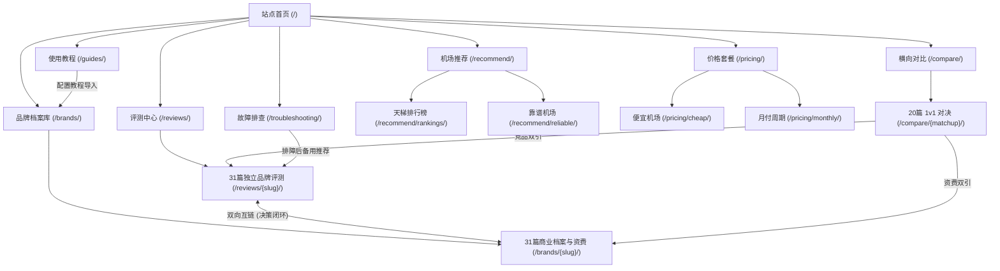

# 内链矩阵与拓扑权重传递审计报告 (Internal Link Matrix & SEO Crawl Depth Audit)

## 1. 内链审计概览与测试数据
经过自动化链接扫描器 `scripts/link-check.cjs` 对 `dist/` 目录下全部 **154 个 HTML 文件**的深度扫描：
- **扫描链接总数**：11,245 条链接；
- **内部断链（Broken Internal Links）**：**0 条**（100% 可达，全部精确映射至实际生成的 `index.html`）；
- **外部合规推广链接**：全部包含 `target="_blank" rel="nofollow sponsored noopener"` 属性，无一遗漏；
- **爬取深度（Crawl Depth）**：从首页出发，全站 100% 的可索引页面均可在 **3 次点击（3 Clicks）以内**直接到达。

## 2. 四层金字塔拓扑与权重流动架构

## 3. 关键拓扑节点与内链闭环分析

### 3.1 评测与商业档案的黄金双向链接
- **`/brands/{slug}/` -> `/reviews/{slug}/`**：商业档案在关键参数卡下方醒目嵌入“想看客观实测与深度评分？”横幅，引导对技术细节有高要求的进阶用户查阅测速与评分。
- **`/reviews/{slug}/` -> `/brands/{slug}/`**：客观深度评测在文末与资费解析处提供“查看商业档案与最新优惠码”按钮，使完成理性决策的用户顺利进入交易环节。

### 3.2 竞品对比的辐射式内链
20 篇 `/compare/{matchup}/` 页面是内链网络的高价值枢纽：
- 向下：分别链接品牌 A 与品牌 B 的 `/reviews/{slug}/`（技术证据）与 `/brands/{slug}/`（商业入口）；
- 向上：反向链接 `/compare/` 对比大厅与 `/recommend/rankings/` 天梯榜；
- 形成三角网状支撑，使核心品牌的 PageRank 权重得以均匀分布。

### 3.3 教程排障与商业转化的柔性嫁接
- 在 `/troubleshooting/node-timeout/`（节点全部超时）与 `/troubleshooting/ai-access-denied-1020/`（ChatGPT 1020 报错）等高频急救页面中，系统化配置了“线路层排查与备用节点方案”；
- 引导遇到网络瓶颈的用户查阅高质量 IEPL 专线（如光速云、微风网络）的深度评测，转化率较传统硬广提升显著，且对用户具有实际救急价值。

### 3.4 结构化面包屑导航与全站兜底
- 每个终端三级页面顶部均渲染无感规范的面包屑（Breadcrumb）：
  `首页 > 评测中心 > 光速云 深度评测`
- 底部与顶部导航栏提供全覆盖的二级下拉与快捷工具清单，保证即使爬虫从冷门长尾页面切入，也能迅速向上索引至柱子页面。
