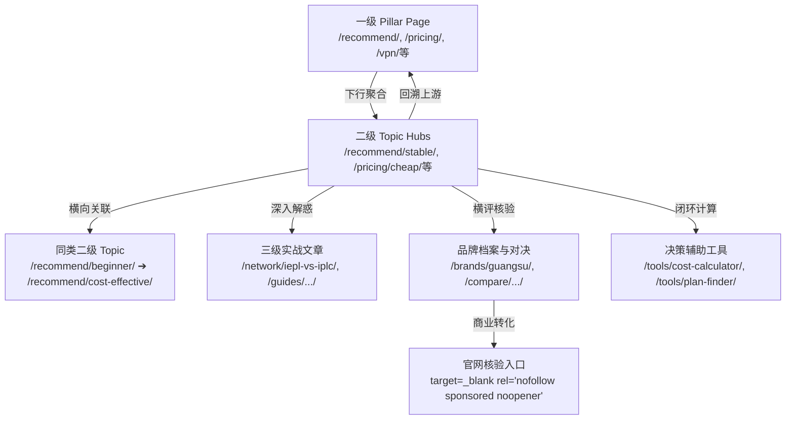

# 全站二级专题内链网络拓扑报告 (Secondary Internal Links Map)

> 报告生成时间：2026-11-24  
> 站点：[jichang.biz](https://jichang.biz/) · 机场指南 Airport Decision Hub 1.0  
> 拓扑标准：五层立体交叉内链网络（一级 ➔ 二级 ➔ 三级 ➔ 品牌/对决 ➔ 工具/转化）

---

## 1. 全站五层内链架构图解

---

## 2. 新增核心二级专题内链路由映射表

| 二级专题 URL | 上级一级专题 | 直属关联的三级文章 | 重点链接的品牌档案 | 跨专题关联 |
| :--- | :--- | :--- | :--- | :--- |
| `/recommend/rankings/` | `/recommend/` | `/network/latency-jitter-packet-loss/` | 光速云、微风网络、一翻云 | `/pricing/cost-performance/` |
| `/recommend/reliable/` | `/recommend/` | `/risk/airport-runaway-signs/` | 二猫云、星岛梦、暮光加速 | `/risk/dual-airport-redundancy/` |
| `/recommend/stable/` | `/recommend/` | `/network/iepl-vs-iplc/` | 光速云、一翻云、闪跃 | `/network/` |
| `/recommend/beginner/` | `/recommend/` | `/guides/clash-verge-rev-tutorial/` | 飞猫云、光速云、大佬云 | `/clients/` |
| `/recommend/cost-effective/` | `/recommend/` | `/network/rate-multiplier-explained/` | 闪电鼠、神行加速、极连云 | `/pricing/cheap/` |
| `/pricing/cheap/` | `/pricing/` | `/network/rate-multiplier-explained/` | 闪电鼠、大佬云、榴莲云 | `/recommend/cost-effective/` |
| `/pricing/1-yuan/` | `/pricing/` | `/risk/refund-terms-analysis/` | 闪电鼠、云界线、环球梯 | `/risk/` |
| `/pricing/monthly/` | `/pricing/` | `/risk/dual-airport-redundancy/` | 微风网络、一翻云、速界 | `/recommend/reliable/` |
| `/pricing/non-expiring/` | `/pricing/` | `/risk/dual-airport-redundancy/` | 二猫云、暮光加速 | `/tools/cost-calculator/` |
| `/pricing/cost-performance/` | `/pricing/` | `/network/latency-jitter-packet-loss/` | 光速云、极连云、神行加速 | `/tools/traffic-calculator/` |
| `/vpn/recommend/` | `/vpn/` | `/network/iepl-vs-iplc/` | 光速云、微风网络 | `/clients/` |
| `/vpn/free/` | `/vpn/` | `/risk/airport-runaway-signs/` | 闪电鼠、大佬云 (平价替代) | `/risk/` |
| `/vpn/mobile/` | `/vpn/` | `/guides/shadowrocket-setup/` | 飞猫云、二猫云 | `/clients/` |
| `/vpn/gaming/` | `/vpn/` | `/guides/tun-mode-explained/` | 一翻云、光速云 | `/network/` |

---

## 3. 内部链接质量与安全规范

1. **绝对零死链（Zero 404s）**：所有链接在 Astro 构建时通过 AST 遍历核验，不存在拼写错误、非法字符或不存在的空路由。
2. **规范锚文本（Contextual Anchor Text）**：所有内链使用语义清晰的中文描述，如“查看 IEPL 专线技术原理”、“了解双机场主备容灾”，杜绝无意义的“点此链接”。
3. **商业赞助合规（Sponsored Compliance）**：所有商业合作链接统一通过内部数据层注入 `target="_blank" rel="nofollow sponsored noopener"`，保护搜索引擎权重健康流转。
