# 二级专题三级文章集群映射报告 (Secondary Topic Clusters)

> 报告生成时间：2026-11-24  
> 站点：[jichang.biz](https://jichang.biz/) · 机场指南 Airport Decision Hub 1.0  
> 核心任务：梳理现有 30 篇高权威三级文章的二级专题归属，并为新增二级专题构建清晰的三级文章集群（Cluster）网络。

---

## 1. 现有 30 篇高权威三级文章归属映射

全站当前已正式发布的 30 篇深度三级文章，已精准对齐至对应二级与一级专题中：

| 所属一级专题 | 所属二级专题定位 | 三级文章真实 URL 与标题 | 核心解决问题与搜索意图 |
| :--- | :--- | :--- | :--- |
| **05. 客户端** | 05.1 Clash Verge | [`/clients/clash-verge-rev/`](file:///c:/Users/Pro%20User/Desktop/jichang.biz/src/pages/clients/clash-verge-rev/) · Clash Verge Rev 深度档案 | 客户端技术架构、内核演进与多配置调度 |
| **05. 客户端** | 05.3 v2rayN | [`/clients/v2rayn/`](file:///c:/Users/Pro%20User/Desktop/jichang.biz/src/pages/clients/v2rayn/) · v2rayN 深度档案 | Windows 平台经典多核心代理调度利器 |
| **05. 客户端** | 05.4 Shadowrocket | [`/clients/shadowrocket/`](file:///c:/Users/Pro%20User/Desktop/jichang.biz/src/pages/clients/shadowrocket/) · Shadowrocket (小火箭) 深度档案 | iOS 平台的规则代理统治级工具与获取 |
| **05. 客户端** | 05.6 sing-box | [`/clients/sing-box/`](file:///c:/Users/Pro%20User/Desktop/jichang.biz/src/pages/clients/sing-box/) · sing-box 官方客户端深度档案 | 通用的次世代通用代理平台与配置结构 |
| **05. 客户端** | 05.8 软路由 | [`/clients/openclash/`](file:///c:/Users/Pro%20User/Desktop/jichang.biz/src/pages/clients/openclash/) · OpenClash 软路由插件深度档案 | 全屋设备透明代理网关部署与内核调试 |
| **06. AI/流媒体** | 06.1 ChatGPT | [`/compatibility/chatgpt-node-guide/`](file:///c:/Users/Pro%20User/Desktop/jichang.biz/src/pages/compatibility/chatgpt-node-guide/) · ChatGPT 节点选择与 Cloudflare 拦截应对 | 破解 1020 报错与高质量解锁节点挑选 |
| **06. AI/流媒体** | 06.2 Claude | [`/compatibility/claude-clean-ip/`](file:///c:/Users/Pro%20User/Desktop/jichang.biz/src/pages/compatibility/claude-clean-ip/) · Claude 干净原生 IP 要求与封号防范实战 | Anthropic 风控深度拆解与防封号 SOP |
| **06. AI/流媒体** | 06.5 Netflix | [`/compatibility/netflix-4k-unlock/`](file:///c:/Users/Pro%20User/Desktop/jichang.biz/src/pages/compatibility/netflix-4k-unlock/) · Netflix 4K 解锁检测与仅自制剧破解 | 看懂版权锁、DNS 流媒体解锁与原生 IP |
| **06. AI/流媒体** | 06.7 TikTok/出海 | [`/compatibility/tiktok-crossborder-setup/`](file:///c:/Users/Pro%20User/Desktop/jichang.biz/src/pages/compatibility/tiktok-crossborder-setup/) · TikTok 跨境电商节点环境配置 | 防黑屏、防限流全景指南与拔卡设置 |
| **07. 线路** | 07.1 专线科普 | [`/network/iepl-vs-iplc/`](file:///c:/Users/Pro%20User/Desktop/jichang.biz/src/pages/network/iepl-vs-iplc/) · IEPL 与 IPLC 物理专线深度科普 | 技术原理、二层切片与假专线防坑鉴别 |
| **07. 线路** | 07.2 物理指标 | [`/network/latency-jitter-packet-loss/`](file:///c:/Users/Pro%20User/Desktop/jichang.biz/src/pages/network/latency-jitter-packet-loss/) · 网络延迟、抖动与丢包率概念详解 | 光速物理极限 RTT 与 TCP 吞吐折损模型 |
| **07. 线路** | 07.7 倍率机制 | [`/network/rate-multiplier-explained/`](file:///c:/Users/Pro%20User/Desktop/jichang.biz/src/pages/network/rate-multiplier-explained/) · 节点倍率真相与扣量陷阱 | 0.1x 到 10x 扣量计算与防偷跑防坑指南 |
| **07. 线路** | 07.4 原生 IP | [`/network/residential-ip-truth/`](file:///c:/Users/Pro%20User/Desktop/jichang.biz/src/pages/network/residential-ip-truth/) · 原生住宅 IP 真伪鉴别与广播 IP 差异 | 解锁风控的终极秘密与 ASN 查询工具 |
| **08. 教程** | 08.2 Clash教程 | [`/guides/clash-verge-rev-tutorial/`](file:///c:/Users/Pro%20User/Desktop/jichang.biz/src/pages/guides/clash-verge-rev-tutorial/) · Clash Verge Rev 完整上手配置教程 | 从安装、订阅导入、分流模式到 TUN 全流程 |
| **08. 教程** | 08.4 小火箭教程 | [`/guides/shadowrocket-setup/`](file:///c:/Users/Pro%20User/Desktop/jichang.biz/src/pages/guides/shadowrocket-setup/) · Shadowrocket (小火箭) 添加管理订阅 | iOS 最主流客户端正版获取与分流配置 |
| **08. 教程** | 08.6 TUN 模式 | [`/guides/tun-mode-explained/`](file:///c:/Users/Pro%20User/Desktop/jichang.biz/src/pages/guides/tun-mode-explained/) · TUN 虚拟网卡模式深度解析 | 解决命令行终端、游戏与后台不走代理底层 |
| **08. 教程** | 08.5 分流规则 | [`/guides/rule-routing-guide/`](file:///c:/Users/Pro%20User/Desktop/jichang.biz/src/pages/guides/rule-routing-guide/) · 代理分流规则详解：DIRECT、PROXY | 深入理解国内外流量分流与规则策略组 |
| **08. 教程** | 08.3 v2rayN教程 | [`/guides/v2rayn-windows-guide/`](file:///c:/Users/Pro%20User/Desktop/jichang.biz/src/pages/guides/v2rayn-windows-guide/) · v2rayN Windows 客户端核心调度指南 | Windows 经典工具 Xray / Sing-box 调度 |
| **08. 教程** | 08.7 软路由教程 | [`/guides/openclash-router-guide/`](file:///c:/Users/Pro%20User/Desktop/jichang.biz/src/pages/guides/openclash-router-guide/) · OpenClash 软路由全屋透明网关部署 | OpenWrt 部署与全屋设备透明分流实操 |
| **08. 教程** | 08.1 订阅安全 | [`/guides/safe-subscription-management/`](file:///c:/Users/Pro%20User/Desktop/jichang.biz/src/pages/guides/safe-subscription-management/) · 订阅链接安全保管、Token 防盗刷 | 防范订阅被爬虫盗用、流量偷跑与重置 SOP |
| **09. 排障** | 09.1 节点超时 | [`/troubleshooting/node-timeout/`](file:///c:/Users/Pro%20User/Desktop/jichang.biz/src/pages/troubleshooting/node-timeout/) · 节点大面积超时 (Timeout / -1ms) 根因与排错 | 系统时间偏差、入口阻断与 TLS 握手故障 |
| **09. 排障** | 09.2 订阅更新失败 | [`/troubleshooting/subscription-update-failed/`](file:///c:/Users/Pro%20User/Desktop/jichang.biz/src/pages/troubleshooting/subscription-update-failed/) · 订阅更新失败、无法解析或下载为空 | 订阅域名污染阻断、死锁状态与备用替换 |
| **09. 排障** | 09.3 连上没网络 | [`/troubleshooting/connected-no-internet/`](file:///c:/Users/Pro%20User/Desktop/jichang.biz/src/pages/troubleshooting/connected-no-internet/) · 节点连接成功但打不开外网网页排查 | 为什么 Ping 得通却打不开网页？DNS 污染排错 |
| **09. 排障** | 09.4 DNS 污染 | [`/troubleshooting/dns-leak-and-pollution/`](file:///c:/Users/Pro%20User/Desktop/jichang.biz/src/pages/troubleshooting/dns-leak-and-pollution/) · DNS 污染与 DNS 泄露诊断处理 | Fake-IP 虚拟 IP 分配与 DoH 加密防御 |
| **09. 排障** | 09.5 端口占用 | [`/troubleshooting/port-conflict-7890/`](file:///c:/Users/Pro%20User/Desktop/jichang.biz/src/pages/troubleshooting/port-conflict-7890/) · 客户端报错 7890 端口占用或崩溃闪退 | 多客户端竞争、卡死进程定位与端口修改 |
| **09. 排障** | 09.6 1020 报错 | [`/troubleshooting/ai-access-denied-1020/`](file:///c:/Users/Pro%20User/Desktop/jichang.biz/src/pages/troubleshooting/ai-access-denied-1020/) · ChatGPT/Claude 提示 Access Denied 1020 | Cloudflare WAF 防火墙拦截原因与高纯净度节点 |
| **09. 排障** | 09.7 退出断网 | [`/troubleshooting/system-proxy-reset/`](file:///c:/Users/Pro%20User/Desktop/jichang.biz/src/pages/troubleshooting/system-proxy-reset/) · 退出客户端后电脑无法访问国内网络？ | 3 秒恢复 Windows / macOS 系统代理注册表残留 |
| **10. 风险** | 10.1 跑路前兆 | [`/risk/airport-runaway-signs/`](file:///c:/Users/Pro%20User/Desktop/jichang.biz/src/pages/risk/airport-runaway-signs/) · 机场跑路前兆与高危特征深度剖析 | 骨折级吸资、静默关群失联与换号跑路信号 |
| **10. 风险** | 10.2 双机容灾 | [`/risk/dual-airport-redundancy/`](file:///c:/Users/Pro%20User/Desktop/jichang.biz/src/pages/risk/dual-airport-redundancy/) · “主力专线 + 平价备用”双机场容灾体系 | 面向跨境办公人群，零月租备用方案防单点故障 |
| **10. 风险** | 10.3 退款真相 | [`/risk/refund-terms-analysis/`](file:///c:/Users/Pro%20User/Desktop/jichang.biz/src/pages/risk/refund-terms-analysis/) · 机场不退款条款真相与维权自保指引 | 数字虚拟服务协议深度解读与小额月付自保 |

---

## 2. 商业与价格二级专题三级文章集群规划

为本次新建的商业高意图二级专题（推荐、价格、VPN）设计的三级文章集群结构：

```mermaid
graph TD
    RecHub[一级专题: 机场推荐 /recommend/] --> R1[二级: 稳定机场 /recommend/stable/]
    RecHub --> R2[二级: 靠谱机场 /recommend/reliable/]
    RecHub --> R3[二级: 新手机场 /recommend/beginner/]
    RecHub --> R4[二级: 性价比机场 /recommend/cost-effective/]
    RecHub --> R5[二级: 机场排行榜 /recommend/rankings/]

    PriceHub[一级专题: 价格与套餐 /pricing/] --> P1[二级: 便宜机场 /pricing/cheap/]
    PriceHub --> P2[二级: 一元机场 /pricing/1-yuan/]
    PriceHub --> P3[二级: 月付机场 /pricing/monthly/]
    PriceHub --> P4[二级: 不限时机场 /pricing/non-expiring/]
    PriceHub --> P5[二级: 性价比核算 /pricing/cost-performance/]

    VpnHub[一级专题: VPN与加速器 /vpn/] --> V1[二级: VPN推荐 /vpn/recommend/]
    VpnHub --> V2[二级: 免费VPN /vpn/free/]
    VpnHub --> V3[二级: 手机VPN /vpn/mobile/]
    VpnHub --> V4[二级: 游戏加速 /vpn/gaming/]
```

